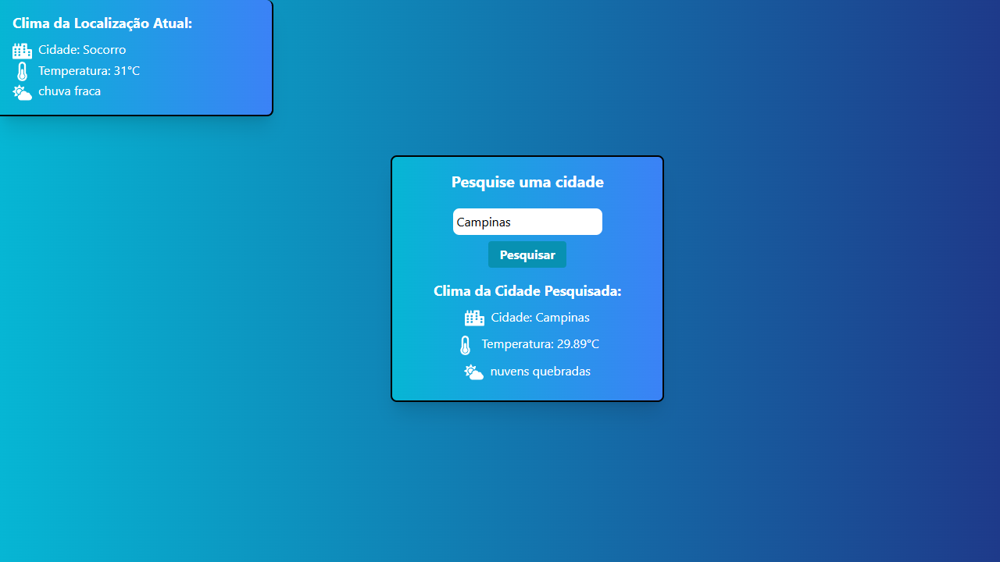

# Consulta Clima

Aplicação React que mostra o clima da sua localização atual assim que a página abre e permite pesquisar a temperatura e as condições de qualquer cidade.


**Demo:** [consulta-clima-ten.vercel.app](https://consulta-clima-ten.vercel.app)



## Funcionalidades

- **Clima da localização atual:** usa a Geolocation API do navegador (com permissão do usuário) para buscar cidade, temperatura e descrição do tempo.
- **Busca por cidade:** pelo botão ou pela tecla Enter.
- **Tratamento de erros:** avisa quando a cidade não existe, quando a geolocalização é negada ou quando a API está indisponível.
- **Respostas em português**, com temperatura em °C.

## Tecnologias

- React 18 (Create React App), com hooks (`useState`, `useEffect`) e um hook customizado `useGeolocation`
- Tailwind CSS 3
- Fetch API para a [OpenWeather Current Weather API](https://openweathermap.org/current)

## Estrutura

```
src/
├── App.js                 # Tela principal: localização atual e busca
├── hooks/useGeolocation.js
├── services/clima.js      # Chamada à API e tratamento das respostas de erro
└── components/icones.js   # Ícones (react-icons)
```

## Como executar

Pré-requisitos: Node.js 18+ e uma chave gratuita da OpenWeather ([criar aqui](https://home.openweathermap.org/api_keys)).

```bash
git clone https://github.com/EldenXLe/Consulta-Clima.git
cd Consulta-Clima
npm install
cp .env.example .env      # e coloque sua chave em REACT_APP_OPENWEATHER_API_KEY
npm start
```

Acesse `http://localhost:3000`.

### Variáveis de ambiente

| Variável | Descrição |
|---|---|
| `REACT_APP_OPENWEATHER_API_KEY` | Chave da OpenWeather. No deploy, configure em *Settings → Environment Variables* da Vercel |

> Em uma aplicação 100% front-end, a chave fica visível no navegador. Por isso ela não fica no repositório: é lida do ambiente.
